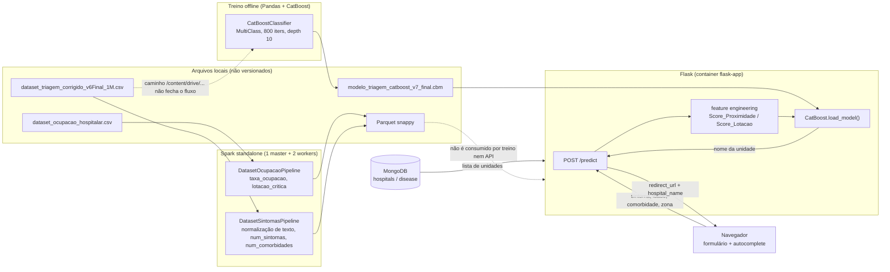

# Projeto GUR — Guia de Urgência Recife

> **Aviso:** este é um **projeto acadêmico / protótipo**. O dataset usado no treino é **sintético**
> (`dataset_triagem_corrigido_v6Final_1M.csv`) e **não está versionado neste repositório**. O modelo
> treinado também **não está versionado**. Nada aqui foi validado clinicamente e o sistema não deve ser
> usado para decisão médica real.

Protótipo de aplicação web que recebe sintoma, idade, comorbidade e zona de residência e sugere uma
unidade de saúde (hospital, UPA, policlínica) do Recife. A sugestão vem de um classificador multiclasse
**CatBoost** treinado offline e servido por uma API **Flask**, com um catálogo de unidades em **MongoDB**
e pipelines de ETL em **PySpark**.

Estado atual do repositório: **código incompleto e não executável de ponta a ponta sem intervenção**
(faltam o modelo `.cbm`, os CSVs e alguns módulos importados). Ver [Limitações conhecidas](#5-limitações-conhecidas).

---

## 1. O que é

- **Protótipo acadêmico**, não produto. Sem testes, sem CI, sem deploy.
- **Dados sintéticos.** O pipeline de ML lê `dataset_triagem_corrigido_v6Final_1M.csv`; o nome e o
  caminho (`/content/drive/MyDrive/...`, típico de Google Colab) indicam um dataset gerado/derivado
  fora do repositório. O conteúdo não é verificável aqui porque o arquivo não está versionado.
- As ~30 unidades de saúde em `database/scripts/insert_data_to_db.py` são dados **hardcoded** (nome,
  descrição, link do Google Maps), sem integração com nenhuma fonte oficial.
- Os indicadores de ocupação hospitalar são calculados por um pipeline separado que **não alimenta o
  modelo nem o site** (ver limitações).

---

## 2. Arquitetura

Quatro blocos que, na prática, rodam de forma **desconexa**:

| Bloco | Onde | Responsabilidade |
|---|---|---|
| ETL Spark | `spark/src/pipelines/` | Lê CSVs, normaliza colunas, grava Parquet |
| Treino ML | `spark/src/pipelines/machine_learning_pipeline.py` | Lê o CSV **bruto** (não o Parquet), treina e salva `.cbm` |
| API Flask | `app/flask_package/` | Carrega o `.cbm`, recebe JSON, devolve hospital e redireciona |
| MongoDB | `database/` | Catálogo de unidades (`hospitals`, `disease`) |



O detalhe importante do diagrama é a **linha pontilhada**: os Parquets gerados pelo Spark e o
`taxa_ocupacao` calculado em `DatasetOcupacaoPipeline` **não são lidos por ninguém**. O treino lê o CSV
original direto com Pandas, e a API recebe a lotação como constante.

---

## 3. Como rodar

> Os passos abaixo foram derivados da leitura de `docker-compose.yml`, dos `Dockerfile` e do código.
> **Não foram executados nem validados neste repositório.** Onde eu não consegui confirmar algo, está
> marcado como não verificado.

### 3.1 Pré-requisitos

- Docker + Docker Compose (v2, por causa de `profiles`)
- Para o treino: Python com `catboost`, `pandas`, `scikit-learn`, `numpy` — e **GPU**, porque o
  `CatBoostClassifier` está fixado com `task_type="GPU", devices='0'`
- Nenhum dataset nem modelo vem junto com o repositório. As credenciais do MongoDB, ao contrário,
  estão hardcoded no código (`admin` / `senha123`) — ver limitações.

### 3.2 O que falta no repositório

O `.gitignore` bloqueia exatamente os artefatos necessários para rodar:

| Faltando | Por quê | Onde deve ficar |
|---|---|---|
| `modelo_triagem_catboost_v7_final.cbm` | `**/.cbm` no `.gitignore` | `app/flask_package/modelo_triagem_catboost_v7_final.cbm` |
| `dataset_triagem_corrigido_v6Final_1M.csv` | `*.csv` e `**/data/csv/` no `.gitignore` | `spark/src/data/csv/` |
| `dataset_ocupacao_hospitalar.csv` | idem | `spark/src/data/csv/` |
| `X_test_features.csv`, `y_test_target.csv` | gerados pelo treino | diretório de execução do treino |
| `utils/csv_to_spark.py` | **importado mas inexistente** (`dataset_sintomas_pipeline.py:4`) | — |
| `pipelines/teste_pipeline.py` | **importado mas inexistente** (`spark/src/main.py:1`) | — |
| `init_database()` | `spark/src/main.py:16` chama essa função, mas o módulo só define `initdatabase()` | — |

Sem o `.cbm`, a aplicação Flask **não sobe**: `app/flask_package/__init__.py:7-8` carrega o arquivo
dentro de `create_app()`, sem `try/except`.

### 3.3 Passo 1 — gerar o modelo

O script `spark/src/pipelines/machine_learning_pipeline.py` está escrito para rodar em Google Colab e
precisa de três ajustes:

1. Trocar o caminho absoluto da linha 8:
   ```python
   PATH_FILE = "/content/drive/MyDrive/dataset_triagem_corrigido_v6Final_1M.csv"
   ```
   por um caminho local para o CSV.
2. Trocar `task_type="GPU"` por `task_type="CPU"` (linha 107) se não houver GPU CatBoost disponível.
3. As dependências de `spark/requirements.txt` já incluem `numpy` e `scikit-learn` (usados nas linhas
   3-5). O que **não** está disponível é GPU: ver item 2.

Depois:

```bash
python machine_learning_pipeline.py
```

Saídas, no diretório de execução: o `.cbm`, `X_test_features.csv` e `y_test_target.csv`.
Para servir na API, copie o modelo:

```bash
cp modelo_triagem_catboost_v7_final.cbm app/flask_package/
```

`predict_model.py` gera `analise_performance_catboost.csv` (hospital real, predito, confiança e acerto
linha a linha), mas **não agrega nada** — não calcula acurácia, F1 nem matriz de confusão.

### 3.4 Passo 2 — rodar o ETL (opcional para a API)

Os pipelines usam caminhos relativos (`../data/csv/...`), então o **diretório de execução precisa ser
`spark/src/pipelines/`**. Dentro do container:

```bash
docker compose --profile backend up -d --build

docker compose exec spark-master bash -c \
  "cd /opt/spark/work-dir/src/pipelines && python dataset_sintomas_pipeline.py"
```

Antes disso é preciso remover a linha 4 de `dataset_sintomas_pipeline.py`
(`from utils.csv_to_spark import csv_to_parquet`), porque o módulo não existe — o import não é usado
no código. O mesmo vale para `hospitals_info_pipeline.py`, que não tem esse problema.

Os Parquets saem em `spark/src/data/parquet/` e **não são usados por mais nada**.

### 3.5 Passo 3 — popular o MongoDB

O script de seed precisa do pacote `database` no `PYTHONPATH`. Como o `host` está hardcoded como
`mongodb` (`database/init_database.py:26-31`), o caminho mais direto é executar de dentro do container:

```bash
docker compose --profile database --profile frontend up -d --build

docker compose exec -e PYTHONPATH=/app:/app/database flask-app \
  python -m database.scripts.insert_data_to_db
```

Atenção: o script faz `insert_many` sem checagem de duplicidade — rodar duas vezes duplica as ~30
unidades.

### 3.6 Passo 4 — subir a stack completa

```bash
docker compose --profile database --profile backend --profile frontend up --build
```

| Serviço | URL |
|---|---|
| Flask (formulário) | http://localhost:5001 |
| Dashboard (gráficos estáticos) | http://localhost:5001/dashboard |
| Spark Master UI | http://localhost:8080 |
| MongoDB | `localhost:27017` (admin / senha123) |

Endpoints:

- `GET /` — formulário + listagem de unidades
- `POST /predict` — corpo `{"sintoma", "idade", "comorbidade", "zona", "lotacao"?}` → `{"hospital_name", "redirect_url"}`
- `GET /hospital/<nome>` — página da unidade (busca por regex, aceita nome parcial)
- `GET /test/predict` — predição com payload fixo, redireciona para a unidade sugerida

Não verificado: se as imagens `apache/spark:3.5.0` e o entrypoint `spark-class` sobem corretamente com
o `docker-compose` deste repositório (há um espaço extra em `SPARK_MASTER= spark://...` nos workers,
o que provavelmente quebra a variável). O Flask **não precisa** do Spark para funcionar: ele só usa
`pymongo` e `catboost`.

---

### Tamanho das imagens

As dependências foram enxugadas e os três serviços Spark passaram a compartilhar uma única imagem
(os workers usam `image: projeto-gur-spark:latest`, definida no `spark-master`; só o master tem
`build`). Valores medidos com `docker build` nesta revisão:

| Imagem | Antes | Depois |
|---|---|---|
| `flask-app` | 2,25 GB | **1,02 GB** |
| `spark` (master + workers) | 3,19 GB × 3 = 9,57 GB | **2,39 GB** (imagem única) |

O que saiu e por quê:

- `pyspark` do `app/requirements.txt` — a API não importa Spark (342 MB).
- `gunicorn`, `requests`, `python-dotenv` do `app/requirements.txt` — zero imports no código.
- `findspark` do `spark/requirements.txt` — zero imports no código.
- `pyspark` do `spark/requirements.txt` — a imagem base `apache/spark:3.5.0` já traz o pacote em
  `/opt/spark/python`; instalar via pip criava uma cópia duplicada de 342 MB.
- `gcc` + `libpq-dev` do `app/Dockerfile` — 251 MB instalados para compilar nada (libpq é do
  PostgreSQL; o projeto usa MongoDB).
- `matplotlib`, `plotly`, `graphviz` (+ `contourpy`, `cycler`, `fonttools`, `kiwisolver`, `pyparsing`,
  `pillow`, `narwhals`) — dependências declaradas obrigatórias do `catboost`, mas nunca importadas
  pelo código. Só `scipy`, entre elas, é realmente carregada no import do catboost.
- Adicionados onde faltavam: `pandas` no app (usado em `routes.py:6`), `numpy` e `scikit-learn` no
  spark (usados em `machine_learning_pipeline.py:3-5`).

### Stack e dependências

**`app/requirements.txt`** — 4 pacotes, todos com import efetivo no código:

```
flask==2.3.3
pymongo==4.6.3
catboost==1.2.8
pandas
```

**`spark/requirements.txt`** — 4 pacotes; `pyspark` vem da imagem base, não do pip:

```
pandas==2.0.3
numpy
scikit-learn
catboost==1.2.8
```

`pandas` é fixado em `2.0.3` no spark porque é a versão com que o treino foi escrito. No app deixe
sem pin: testado que `pandas==2.0.3` com `numpy` 2.x quebra no import
(`ValueError: numpy.dtype size changed`).

**Outros componentes:** Flask 2.3.3, Jinja2, MongoDB (`mongo:latest`) + PyMongo 4.6.3, CatBoost 1.2.8,
PySpark 3.5.0 (standalone: 1 master + 2 workers), Docker Compose, Bootstrap 4.5.2 via CDN.

**Ausentes:** nenhum teste, nenhum lint/CI, nenhum lockfile, README sem instruções até esta revisão.

---

## 4. O modelo

**Algoritmo:** `catboost.CatBoostClassifier` (`catboost==1.2.8`), classificação **multiclasse** onde
cada classe é uma unidade de saúde (`Hospital_Recomendado`).

**Hiperparâmetros** (`machine_learning_pipeline.py:102-112`):

| Parâmetro | Valor |
|---|---|
| `iterations` | 800 |
| `learning_rate` | 0.03 |
| `depth` | 10 |
| `l2_leaf_reg` | 4 |
| `loss_function` | `MultiClass` |
| `task_type` | `GPU`, `devices='0'` |
| `early_stopping_rounds` | 50 |
| `eval_set` | `(X_test, y_test)` |

**Split:** 80/20, `stratify=y`, `random_state=42` (`machine_learning_pipeline.py:80-82`).

**Features (10)** — `machine_learning_pipeline.py:59-64`:

| Feature | Tipo | Origem |
|---|---|---|
| `Sintoma` | categórica | entrada do usuário (texto livre validado contra `config_sintomas_base.py`) |
| `Comorbidades` | categórica | entrada do usuário |
| `Idade` | numérica | entrada do usuário |
| `Complexidade` | categórica | lookup em `SINTOMAS_BASE` (`baixa`/`moderada`/`alta`) |
| `Gravidade` | categórica | lookup em `SINTOMAS_BASE`, ajustada por idade ≥ 60 em `ajustar_gravidade_por_idade` |
| `Horario` | categórica | derivada da hora do servidor (`manha`/`tarde`/`noite`/`madrugada` no treino; `Madrugada`/`Diurno`/`Noturno` em produção) |
| `Zona_Residencia` | categórica | entrada do usuário (`Zona Oeste`/`Sul`/`Norte`/`Centro`) |
| `Lotacao_No_Momento` | numérica 0–1 | **constante `0.7`** em produção (`routes.py:108`) |
| `Score_Proximidade` | numérica 0–1 | lookups hardcoded `zona × hospital` (`routes.py:9-49`) |
| `Score_Lotacao` | numérica | `1 - Lotacao_No_Momento` |

**Saída em produção:** apenas o nome da classe vencedora (`routes.py:157`,
`predict().flatten()[0]`). O modelo sabe produzir `predict_proba`, e o treino até imprime a matriz de
probabilidades no exemplo de simulação, mas **a API não devolve probabilidade nem top-k**.

**Categorias:** `cat_cols` (6 features) é passado como `cat_features` no `fit`, então o CatBoost faz o
encoding internamente por target statistics. Não há `OneHotEncoder` nem `LabelEncoder` no projeto.

**Sobre métricas:** o código chama `classification_report(y_test, y_pred)` duas vezes (geral e apenas
classes contendo "UPA") e importa `top_k_accuracy_score`/`accuracy_score` — **esses dois últimos nunca
são usados**. O repositório contém quatro PNGs em `app/flask_package/static/graficos/`
(`grafico_acuracia_geral.png`, `f1_score_por_classe.png`, `matriz_confusao_transparente.png`,
`roc_curve.png`) **sem o script que os gerou**, e nenhum número de métrica aparece em texto, log ou
notebook. Portanto **não há nenhuma métrica reproduzível neste repositório** e nenhuma é citada aqui.

---

## 5. Limitações conhecidas

**1. Dataset sintético, não versionado e não auditável.**
O treino lê um CSV de ~1M linhas que não está no repo. Não há script de geração, dicionário de dados,
nem descrição da distribuição das classes. Nenhuma conclusão sobre qualidade ou representatividade é
possível. Além disso, o alvo `Hospital_Recomendado` é uma recomendação do próprio dataset, não um
desfecho clínico observado.

**2. Provável vazamento de alvo em `Score_Proximidade`.**
`machine_learning_pipeline.py:42-46` calcula `Score_Proximidade` a partir do **próprio alvo**:

```python
df_feat['Score_Proximidade'] = df_feat.apply(
    lambda x: proximidade_map.get(x['Zona_Residencia'], {}).get(x['Hospital_Recomendado'], 0.1),
    axis=1
)
```

Ou seja, durante o treino a feature é derivada de `y`. Na inferência essa coluna não existe no input e
é preenchida de outro jeito (`routes.py:36-45` usa o hospital-alvo do PROCAPE ou o máximo da zona), ou
seja, **a distribuição da feature muda entre treino e produção**. Qualquer métrica obtida com esse
setup está inflada e não se transfere para o uso real.

**3. Divergência de categorias entre treino e inferência.**
O pipeline Spark normaliza tudo para minúsculas (`dataset_sintomas_pipeline.py:13, 17, 21, 40, 48`):
`manha/tarde/noite/madrugada`, `gravidade ∈ {leve, moderada, grave, critica}`. Já a API envia
`"Madrugada"`, `"Diurno"`, `"Noturno"` (`routes.py:94-100`), e `config_sintomas_base.py` contém
`"gravidade": "moderado"` (linha 5) e `"alta"` como gravidade (linha 21) — valores que o treino mapeia
para outra coisa. O formulário ainda envia `"Nenhuma"`, `"Hipertensao"` capitalizados
(`index.html:63-68`). Todos caem em categorias não vistas pelo modelo, sem erro: o CatBoost usa o
default e a predição degrada silenciosamente.

**4. Spark e modelo são dois projetos paralelos.**
- O Spark lê CSV e grava Parquet; o treino lê o CSV bruto via Pandas de um caminho de **Google Colab**.
- Nenhum script consome os Parquets.
- `taxa_ocupacao` e `lotacao_critica` (`hospitals_info_pipeline.py:45-53`) nunca chegam ao modelo.
- Não há orquestração (Airflow, cron): cada pipeline é um `__main__` manual, com caminhos relativos
  que dependem do diretório de execução.

**5. Lotação fixa em produção.**
`routes.py:108` usa `data.get("lotacao", 0.7)` e o frontend **não envia** esse campo. Então
`Lotacao_No_Momento` é sempre `0.7` e `Score_Lotacao` sempre `0.3` em toda predição real — a feature
está morta. A única "ocupação" que o modelo poderia usar nunca é atualizada, apesar de existir um
pipeline que calcula isso.

**6. Sem testes.**
Não há nenhum arquivo de teste, nenhum `pytest`/`unittest`, nenhum CI. Também não há lint, lockfile
ou checagem de tipos. Os erros de import citados em 3.2 mostram que o código não foi executado como
um todo depois do último commit.

**Outros problemas encontrados**

- `spark/src/main.py` não roda: importa módulos inexistentes e chama `init_database()`, que não existe
  (o módulo define `initdatabase()`).
- `database/init_database.py:43` desempacota 2 valores de uma função que retorna 1 → `ValueError`.
- `insert_data_deases()` insere doenças na **coleção de hospitais**, porque chama `initdatabase()`,
  que retorna `hospital_col`.
- `HospitalModel.delete()` chama `delelte_one` (typo, `hospitals_model.py:22`).
- `/predict` monta `hospital_url` (linha 166) e nunca usa; o mapeamento `HC/UFPE → Hospital das
  Clínicas` depende de um `if` que também não é usado no caminho de sucesso.
- Credenciais em claro (`admin` / `senha123`) em `docker-compose.yml` e `init_database.py`, MongoDB
  exposto na 27017, Flask com `debug=True` (`run.py:5`), e busca por regex com input do usuário
  (`routes.py:78-80`).
- Artefatos mortos: `app/templates/teste.html`, `database/scripts/verify_path.py`,
  `spark/src/utils/spark_session.py` (usado só pelos pipelines) e as imagens de gráficos sem gerador.
- `machine_learning_pipeline.py` importa `sklearn` e `numpy`, mas nenhum dos dois estava declarado em
  `spark/requirements.txt` (corrigido — ver seção 7).

---

## 6. Próximos passos

Ordenados por impacto. Cada item ataca uma limitação da seção 5.

**Corrigir o vazamento de alvo (limitação 2) — prioridade máxima.**
Trocar `Score_Proximidade` por uma feature que **não dependa do alvo**. Opções: distância real
(haversine) entre a zona/bairro do paciente e as coordenadas da unidade, ou um score por zona
calculado *antes* do split e sem consultar `Hospital_Recomendado`. Fazer o **mesmo** cálculo no treino
e na inferência, de preferência extraindo para um módulo compartilhado (ex.: `shared/features.py`)
usado pelos dois lados. Só depois disso remedir.

**Unificar o encoding das categorias (limitação 3).**
Definir os domínios como constantes em um único módulo: `GRAVIDADE = {leve, moderada, grave, critica}`,
`HORARIO = {manha, tarde, noite, madrugada}`, `COMORBIDADE = {nenhuma, hipertensao, ...}`. Aplicar
`strip().lower()` e um mapa explícito de sinônimos na borda da API. Validar com `Schema` (Pydantic ou
`marshmallow`) e **rejeitar** valor fora do domínio em vez de deixar o CatBoost usar o default.
Idealmente, salvar os domínios junto do modelo e checar `feature_names_` no boot.

**Ligar o Spark ao modelo (limitação 4).**
Fazer o treino ler o Parquet produzido por `DatasetSintomasPipeline` em vez do CSV bruto, e mover o
pré-processamento para um único lugar (ou Spark, ou Pandas — não os dois). Criar uma etapa que grave
`taxa_ocupacao` no MongoDB e um job que atualize esse valor periodicamente; a API passa a ler de lá.
Adicionar orquestração mínima (um `Makefile`/`dags` simples serve) e parametrizar os caminhos por
variável de ambiente em vez de `../data/csv/...`.

**Popular a lotação de verdade (limitação 5).**
Fazer o frontend enviar `lotacao` (ou o backend buscar por `unidade_id` no MongoDB), remover o default
silencioso `0.7` e retornar erro explícito quando o dado não existir. Registrar no retorno qual valor
foi usado, para o usuário saber que a recomendação considerou ocupação.

**Criar uma suíte mínima de testes e tornar o repo executável (limitações 1 e 6).**
- Testes de contrato: `/predict` com payload válido/inválido, categorias fora do domínio, modelo
  ausente.
- Teste de consistência treino↔inferência: o mesmo dicionário de features passando pelos dois
  caminhos deve produzir o mesmo vetor.
- Smoke test de import de cada módulo (isso já teria pego `utils.csv_to_spark`, `teste_pipeline` e
  `init_database`).
- CI rodando `pytest` + `ruff`/`flake8` em PR.
- Remover imports mortos, corrigir `delelte_one`, corrigir `init_database()` e o seed de doenças.
- Mover segredos para `.env` (já existe `python-dotenv` nas dependências), fechar a porta do MongoDB
  e desligar `debug=True` fora de desenvolvimento.

**Documentar o dataset e as métricas (limitação 1).**
Commitar o script de geração (ou um amostra anonimizada), um dicionário de dados e a distribuição de
classes. Reescrever a avaliação em um script versionado que produza `classification_report`,
matriz de confusão e uma baseline (ex.: `DummyClassifier` com a classe majoritária) para dar sentido
a qualquer número. Só então colocar métricas no README — com a ressalva de que o dataset é sintético.

**Versionar o modelo de forma controlada.**
Publicar o `.cbm` como release/tag ou usar um registry simples (MLflow, DVC), com hash e data, e
fazer o carregamento no Flask falhar de forma explícita e legível quando o artefato não existir.

---

## Estrutura do repositório

```
app/                        # Flask
  flask_package/
    __init__.py             # cria app e carrega o .cbm
    run.py                  # entrypoint (porta 5000)
    routes.py               # /, /predict, /hospital/<nome>, /dashboard, /test/predict
    config_sintomas_base.py # sintomas → complexidade/gravidade + lista PROCAPE
  templates/                # index, hospital, dashboard
database/
  init_database.py          # conexão Mongo + criação das coleções
  model/hospitals_model.py  # CRUD
  scripts/insert_data_to_db.py  # seed hardcoded das unidades
spark/
  src/pipelines/
    pipeline_base.py              # leitura CSV + escrita Parquet
    dataset_sintomas_pipeline.py  # normalização do dataset de triagem
    hospitals_info_pipeline.py    # taxa de ocupação
    machine_learning_pipeline.py  # treino CatBoost
    predict_model.py              # inferência em lote sobre o test set
  src/utils/spark_session.py      # SparkSession para spark://spark-master:7077
docker-compose.yml          # mongodb, spark-master, 2 workers, flask (por profile)
```
